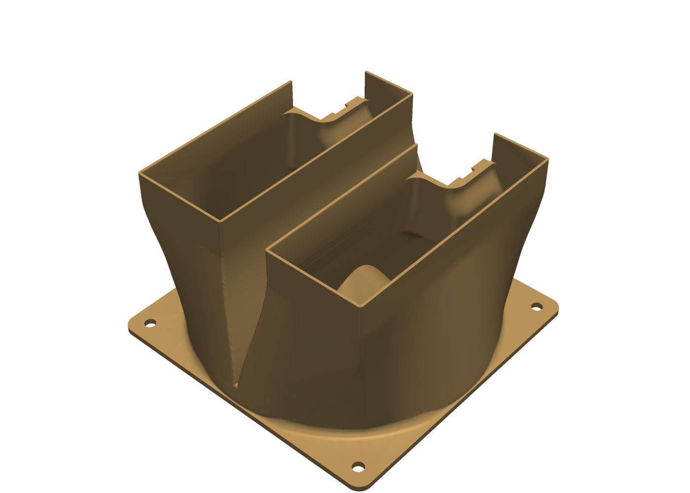
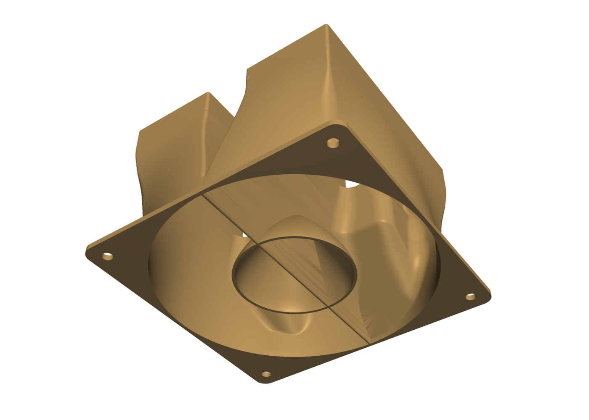
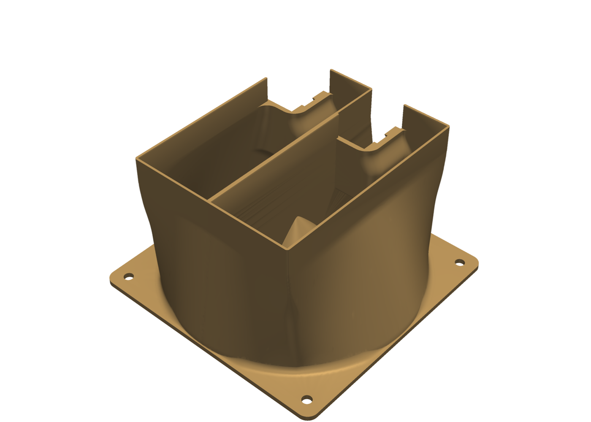
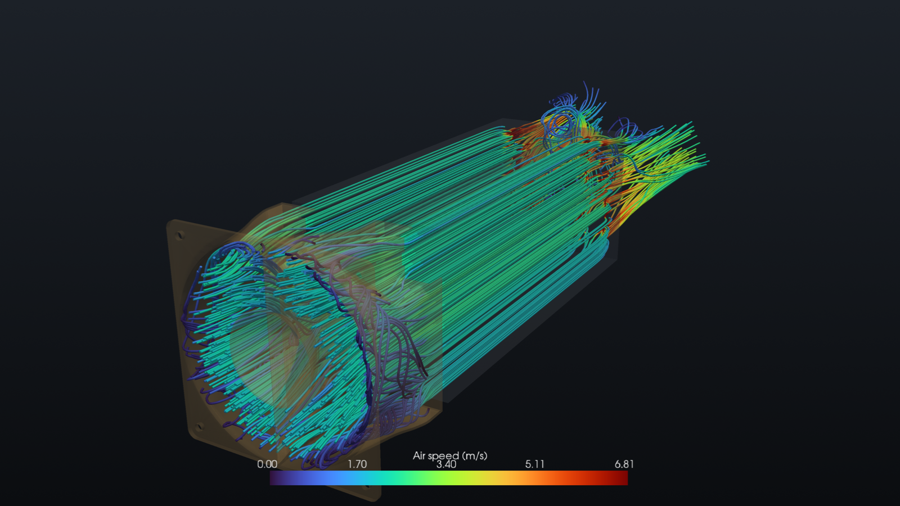

# Dual CMP 170HX fan duct

3D-printable ducting that cools two passively cooled NVIDIA CMP 170HX cards with one 120 mm fan (ARCTIC P12 Pro PST CO). A push duct on the cards' front ends feeds both cards; optional exhaust collectors on the rear slot brackets add a second, pulling fan. Everything is parametric Python (manifold3d + shapely), checked for printability before release, and screened with OpenFOAM CFD.

**Status: experimental.** The A30 duct is printed and in use in the author's machine (and an early revision before it). V30 has not been printed yet. **No exhaust collector (flat rear panel or Fractal plug) has ever been printed or fitted**: their fit, seal and airflow gain are model results only. The CFD and thermal models are uncalibrated: treat every flow and temperature number here as a model result for comparing designs, not a GPU temperature prediction.

<p align="center">
  
  
  
</p>
<p align="center">
  
</p>

## Releases

**[Browse the releases](https://adrienbrault.github.io/cmp-170hx-duct/)**: each release has an interactive 3-D preview (the STL in a model of the case and cards, with the simulated airflow where there is a run), print notes and the check results. The same pages are in [`releases/`](releases/).

| Part | Folder | Notes |
|---|---|---|
| **V30** push duct, cards one slot apart (3-slot pitch, 60.96 mm) | [`releases/v30/`](releases/v30/) | P1S / 0.28 mm PETG: ~156 min, 72 g, no supports |
| **A30** push duct, adjacent cards (2-slot pitch, 40.64 mm) | [`releases/a30/`](releases/a30/) | ~146 min, 68 g, no supports |
| Exhaust collector for a flat rear panel (4-slot / 5-slot): **untested, never printed or fitted** | [`releases/collector-v4-4slot/`](releases/collector-v4-4slot/), [`collector-v4-5slot/`](releases/collector-v4-5slot/) | second 120 mm fan, pulling |
| Fit gauge for a recessed slot bay (Fractal) | [`releases/fractal-fit-gauge/`](releases/fractal-fit-gauge/) | prints in ~26 min; the plug collector it checks is an **untested draft** |

Each duct folder has the STL, a 10 mm fit-check ring (print it first), `PRINT-NOTES.md`, `checks.json` and the slicer results. Older releases (V23-V29, collectors v1-v3) are kept for reference and as regression fixtures.

V30 and A30 are V29 / A29 with an ogive fairing behind the fan's motor hub; it is sized for the P12 Pro's ~52 mm rear hub face. Print fan face down, without supports. Do not scale an STL to adjust the fit: that changes the card pitch and the fan hole spacing. Change the parameters and rebuild instead.

## Using the code

The STLs and preview pages are stored with [Git LFS](https://git-lfs.com/): install it before cloning (or run `git lfs pull` afterwards), otherwise those files are small pointer files. Downloading a single STL from the GitHub web page works without it.

Requires Python 3.12+ and [uv](https://docs.astral.sh/uv/). Optional: Bambu Studio (slicer checks) and OpenFOAM v2606 (CFD); `uv run duct doctor` reports what it finds.

```sh
uv sync
uv run duct cad --preset v30 --out build/v30      # build and export a duct
uv run duct verify build/v30/dual-170hx-continuous-v30.stl --preset v30   # fit, printability and seal checks
uv run duct verify --fast --draft --preset v30    # quick, coarse preview of the gates while iterating (never a release)
uv run duct release v30                           # build, gate, slice and package releases/v30 (refuses on a failed gate)
uv run duct estimate                              # lumped fan/system/thermal estimate: rpm, stacked fans, push-pull
uv run duct simulate NAME --preset v30            # CAD -> OpenFOAM case -> flow -> thermal -> airflow page in runs/NAME
uv run pytest -n 4 --dist loadfile                # the test suite (see docs/testing.md)
```

`uv run duct --help` lists every command. Designs are dataclass presets in [`duct/params.py`](duct/params.py) (`GeometryParams` for ducts, `CollectorParams` for collectors); the case and card hardware the parts are checked against is in [`duct/cad/hardware.py`](duct/cad/hardware.py).

| Path | |
|---|---|
| `duct/cad/` | duct, collector, plug and gauge geometry; hardware model and fit checks |
| `duct/print/` | printability gates (overhang, solid regions, seal, seat coverage, slicer), verify, release |
| `duct/cfd/`, `solvers/` | OpenFOAM case builder, fan model, porous fin zones; the fin/air/base thermal solver (`chtFinBase`) |
| `duct/viz/`, `templates/` | the self-contained preview and airflow pages |
| `profiles/slicer/` | Bambu P1S / 0.4 mm / 0.28 mm PETG profiles used by the slicer gate |
| `docs/` | design notes: collector constraints and plans, push-side aero, testing |

## What the models say, and what they don't

- Flow: OpenFOAM v2606 (`porousSimpleFoam`, k-omega SST), full 267 mm card envelopes with Darcy-Forchheimer fin zones (estimated, uncalibrated coefficients), the P12 Pro fan curve at 2500 rpm, 25 °C intake, 250 W per card. A custom coupled fin/air/copper-base thermal model runs on the flow field.
- Duct shape refinements change the modeled peak temperature by tenths of a kelvin: within the model's resolution. Fan configuration matters far more: a pulling exhaust collector adds ~35-40 % airflow (about 10 K lower modeled peak), more than any duct-shape change.
- The useful next evidence is physical: same card power, fan speed and intake temperature, comparing steady GPU telemetry with and without each part.

## Licensing

MIT (see [`LICENSE`](LICENSE)), except [`solvers/`](solvers/), which builds against OpenFOAM and is GPL-3.0 (see [`solvers/LICENSE.md`](solvers/LICENSE.md)).
